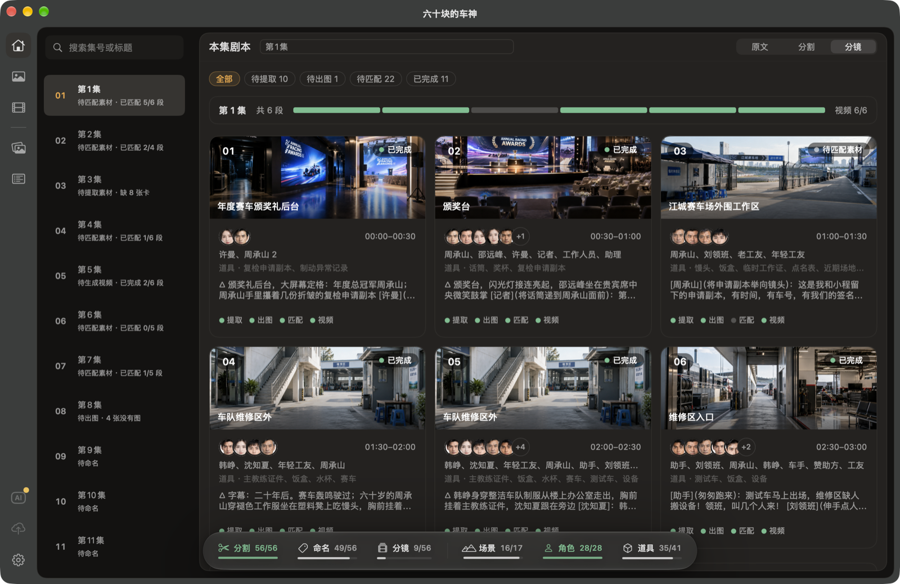
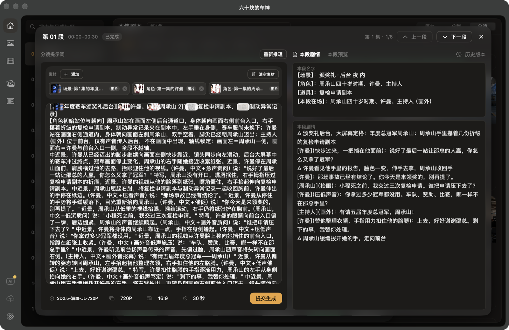
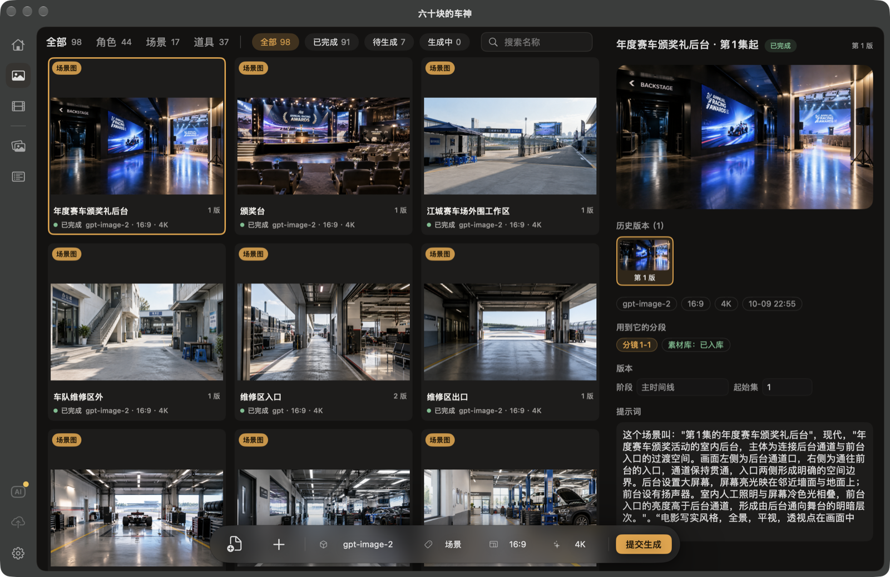

# 嬉皮小剧场 · Xipixiaojuchang

[English](#english)

一个 macOS 原生应用（SwiftUI），把一部短剧剧本一步步做成 AI 视频：从剧本分集、按时长切分、推理分镜，到提取角色 / 场景 / 道具、生成素材图，再到逐段生成视频，都在同一个工作台里完成。



| 段落详情：分镜提示词 + 本段剧情 | 素材卡：角色 / 场景 / 道具 |
|---|---|
|  |  |

> 截图来自作者用本软件制作的短剧《六十块的车神》。

## 能做什么

- **剧本流水线**：AI 分集 → 时长分割（如每段 15 / 30 秒）→ 分段命名 → 推理分镜 → 提取素材（角色、场景、道具）。每一步的提示词都能在设置里改。
- **工作台**：按集、按段看每一段走到了哪一步（待命名、待推理、待出图、待生成视频……），点进某一段可以改提示词、挂素材、看历史版本。
- **素材与生图**：提取出的素材自动建成生图卡；跨集复用同一素材，提取时会和已有素材对账（沿用 / 新建 / 形态变化 / 待确认），不会重复建卡。
- **生视频**：每一段带着挂好的参考图（以及参考视频、音频）提交给视频服务商；每次提交都是新的一版，失败的版本也保留，可以改了再交。
- **服务商接入**：生图、生视频渠道支持 OpenAI 规范和 New API 两种接入规范；文字流程可接 OpenAI 兼容的接口（如 DeepSeek），支持流式接收。
- **外部智能体接力**：文字流程可以不走软件里的 API，而是把请求放进本机收件目录，由 Codex 等外部智能体回答。配套的自动化技能在 [`skills/xipi-automation`](skills/xipi-automation)。

## 下载安装

到 [Releases](https://github.com/xipiplay/xipixiaojuchang-oss/releases) 下载最新的 `Xipixiaojuchang-Open-x.y.z.dmg`，打开后把应用拖进「应用程序」。

安装包没有经过 Apple 公证，第一次打开会提示「无法验证开发者」。处理方法任选一种：

- 在「应用程序」里**右键**点应用 →「打开」→ 再点「打开」；
- 或者在终端执行：

```bash
xattr -dr com.apple.quarantine "/Applications/嬉皮小剧场开源版.app"
```

## 系统要求

- macOS 26 或更高
- Xcode（含 Swift 6 工具链）

## 从源码构建

```bash
swift build -c release
```

打包成 `.app` 并安装到 `~/Applications`（会先让正在运行的旧版存盘退出，再启动新版）：

```bash
./scripts/make_app.sh
```

只打 dmg 安装包（不安装）：

```bash
./scripts/make_dmg.sh
```

运行测试：

```bash
swift test
```

> 如果系统默认的开发者目录不是完整的 Xcode，先执行 `export DEVELOPER_DIR=/Applications/Xcode.app/Contents/Developer`。

## 使用前需要自己准备

- 文字模型、生图、生视频服务商的 API 地址和 Key，在应用的「设置」里添加。Key 只存在本机的应用设置里，不会写进项目文件。
- 生图、生视频按各服务商的规则收费，费用由你和服务商结算。
- 参考素材需要公网直链的服务商，要在设置里配置上传方式（如阿里云 OSS）。

## 数据存放位置

- 应用数据：`~/Library/Application Support/XipixiaojuchangOpen/`
- 项目（剧本、分镜、素材图、视频）：在设置里选定的项目文件夹

## 目录结构

| 目录 | 内容 |
|---|---|
| `Sources/Xipixiaojuchang` | 应用源码 |
| `Tests/XipixiaojuchangTests` | 单元测试 |
| `Resources` | Info.plist、图标、内置提示词（`Resources/Prompts`） |
| `scripts` | 打包、图标、压测脚本 |
| `skills/xipi-automation` | 外部智能体自动化技能（`SKILL.md`、`xipi.py`） |

## 许可证

[MIT](LICENSE)

本项目与文中提到的各 AI 服务商没有隶属关系；各服务的名称归其所有者所有。

---

## English

**Xipixiaojuchang** is a native macOS app (SwiftUI) that turns a short-drama script into AI-generated video, end to end, in a single workbench:

- **Script pipeline**: split the script into episodes → cut each episode into fixed-length segments (e.g. 15 / 30 s) → name segments → infer storyboards → extract assets (characters, scenes, props). Every step's prompt is editable.
- **Workbench**: see where each segment stands (needs naming, needs storyboard, needs images, needs video…), open a segment to edit its prompt, attach assets, and browse version history.
- **Assets & images**: extracted assets become image cards; assets are reused across episodes and reconciled on re-extraction (reuse / new / changed form / needs review) instead of being duplicated.
- **Video generation**: each segment is submitted with its reference images (and optional reference video / audio). Every submission is a new version; failed versions are kept and can be edited and resubmitted.
- **Providers**: image and video channels speak either the OpenAI-style protocol or the New API protocol; text steps work with OpenAI-compatible endpoints (e.g. DeepSeek), with streaming.
- **External agent bridge**: instead of calling an API, text-pipeline requests can be dropped into a local inbox and answered by an external coding agent such as Codex. See [`skills/xipi-automation`](skills/xipi-automation).

The UI and prompts are in Chinese.


### Download

Grab the latest `Xipixiaojuchang-Open-x.y.z.dmg` from [Releases](https://github.com/xipiplay/xipixiaojuchang-oss/releases). The app is not notarized: on first launch, right-click the app in Applications → Open, or run `xattr -dr com.apple.quarantine "/Applications/嬉皮小剧场开源版.app"`.

### Requirements

macOS 26+, Xcode with the Swift 6 toolchain.

### Build

```bash
swift build -c release
./scripts/make_app.sh   # bundles the .app, installs it to ~/Applications and launches it
swift test
```

### Before you start

Add your own text / image / video provider endpoints and API keys in Settings. Keys stay in the app's local preferences and are never written into project files. Image and video generation are billed by the providers you configure.

### License

[MIT](LICENSE). This project is not affiliated with any of the AI service providers it supports.
